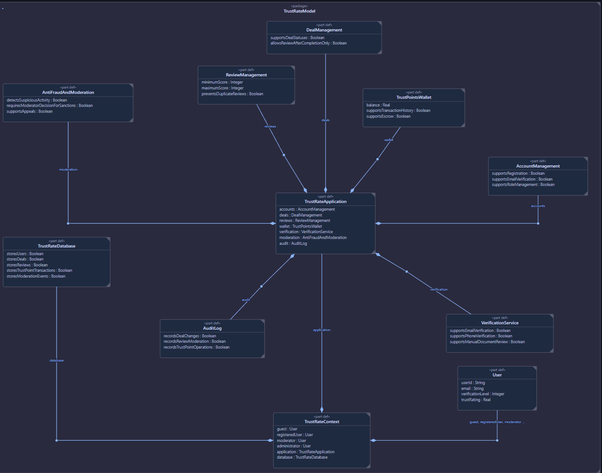

# TrustRate

Система репутации и рейтинга пользователей.

## О проекте

TrustRate — веб-приложение для формирования репутации пользователей на основе завершённых сделок, отзывов, уровня верификации и истории поведения.

Основная цель системы — повысить доверие между участниками онлайн-сделок и снизить риск мошенничества.

## Документация

Основная спецификация требований к системе:

[Открыть SRS](Lab3/srs/srs-template.md)

Дополнительная документация:

- [Словарь терминов проекта](Lab3/srs/TrustRate-Glossary.md)
- [Спецификации вариантов использования](Lab3/srs/TrustRate-Use-Case-Specifications.md)
- [План реализации](Lab3/srs/Implementation-Backlog.md)

## Модель системы

Основная модель системы в SysML v2:

[Открыть модель SysML](Lab3/srs/models/trustrate-model.sysml)

## UML-диаграммы

Для описания структуры и поведения системы разработаны следующие диаграммы:

- [Диаграмма вариантов использования](Lab3/srs/UML/TrustRate-Use-Case.puml)
- [Диаграмма деятельности](Lab3/srs/UML/TrustRate-Activity-Deal-Review.puml)
- [Диаграмма состояний сделки](Lab3/srs/UML/TrustRate-State-Deal.puml)
- [Диаграмма последовательности](Lab3/srs/UML/TrustRate-Sequence-Deal-Review.puml)

## Архитектурная документация

### SDD — Software Design Description

[Открыть описание проектирования системы](Lab3/srs/SDD/SDD-TrustRate.md)

### ADR — Architecture Decision Records

В каталоге ADR хранятся документы, описывающие принятые архитектурные решения:

- [ADR-001 — Многослойная монолитная архитектура](Lab3/srs/ADR/ADR-001-layered-monolith.md)
- [ADR-002 — PostgreSQL](Lab3/srs/ADR/ADR-002-postgresql.md)
- [ADR-003 — Расчёт рейтинга и TC](Lab3/srs/ADR/ADR-003-rating-and-tc.md)
- [ADR-004 — Моделирование вариантов использования](Lab3/srs/ADR/ADR-004-use-case-modeling.md)
- [ADR-005 — Сценарий сделки и отзывов](Lab3/srs/ADR/ADR-005-deal-review-scenario.md)
- [ADR-006 — Диаграмма состояний сделки](Lab3/srs/ADR/ADR-006-deal-state-machine.md)
- [ADR-007 — Спецификации вариантов использования](Lab3/srs/ADR/ADR-007-use-case-specifications.md)

## Иллюстрация системы

